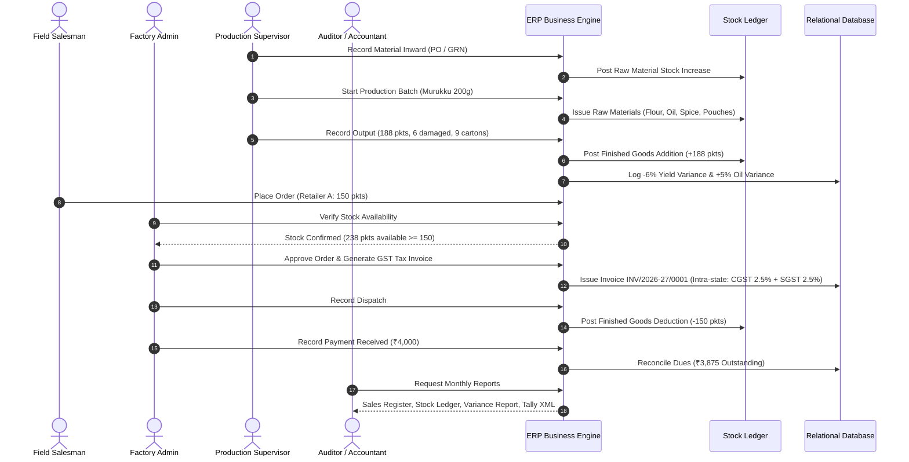

# SYSTEM ARCHITECTURE & MODULAR DESIGN
## Dakshin ERP (SnackFlow Operating System)
### Enterprise Order-to-Audit Manufacturing Platform

---

## 1. Executive Architecture Summary

Dakshin ERP is designed as a modular, layered enterprise application adhering to clean architecture principles:
- **Separation of Concerns:** Business logic is decoupled from presentation and database access.
- **Transactional Consistency:** Stock, finances, and audit logs transition atomically.
- **Extensible Integration:** Exposes clean export layers for Tally Prime, GST filing preparation, and PDF document vaults.

---

## 2. Multi-Layer Modular Topology

```
+---------------------------------------------------------------------------------------+
|                                  PRESENTATION LAYER                                   |
|   Responsive PWA Web Shell  ·  Mobile Drawer  ·  Light Purple Design System (#7C3AED) |
|   Jinja2 Dynamic Templates  ·  Client-side Autocomplete Search  ·  SVG Visualizations |
+---------------------------------------------------------------------------------------+
                                           │
                                           ▼
+---------------------------------------------------------------------------------------+
|                               API & CONTROLLER LAYER                                  |
|   Flask Blueprints (Auth, Sales, Admin, Production, Procurement, Quality, Reports...) |
|   RBAC Security Interceptors (@login_required)  ·  Centralized Error Handlers         |
+---------------------------------------------------------------------------------------+
                                           │
                                           ▼
+---------------------------------------------------------------------------------------+
|                            APPLICATION & BUSINESS LOGIC                               |
|   BOM Engine       ·  Zero-Drift Stock Engine  ·  GST Tax Rules Engine (Intra/Inter)  |
|   MRP Planner      ·  WAC Costing Engine       ·  Quality Gatekeeper & Release Logic  |
|   FEFO Dispatcher  ·  Alerts & RCA Monitor     ·  Receivables & Aging Calculations    |
+---------------------------------------------------------------------------------------+
                                           │
                                           ▼
+---------------------------------------------------------------------------------------+
|                             DATA ACCESS & PERSISTENCE                                 |
|   Relational SQLite (WAL Mode)  ·  PRAGMA foreign_keys = ON  ·  Atomic Transactions   |
|   Perpetual Stock Ledger        ·  Financial Year Doc Sequence Generators             |
+---------------------------------------------------------------------------------------+
                                           │
                                           ▼
+---------------------------------------------------------------------------------------+
|                               INTEGRATION & EXPORT                                    |
|   ReportLab PDF Engine  ·  OpenPyXL Excel Builder  ·  Tally Prime Native XML Exporter  |
+---------------------------------------------------------------------------------------+
```

---

## 3. The Dual-Loop Business Intersection

The core architectural problem defined in the NIT Tiruchirappalli Winter Internship Problem Statement is the seamless synchronization of two operational loops:
1. **The Production Loop (Supply & Value Addition):** Raw materials purchased $\to$ Inwarded to raw stock $\to$ Issued against Bill of Materials (BOM) $\to$ Machine & labor overheads applied $\to$ Yield & usage variances flagged $\to$ Finished goods inventory increments.
2. **The Sales Loop (Demand & Value Realization):** Mobile field order captured $\to$ Admin stock availability check $\to$ GST tax invoice raised $\to$ Dispatch deducts finished goods inventory $\to$ Outstanding receivables tracked $\to$ Payments reconciled.



---

## 4. Key Subsystem Implementation Architecture

### 4.1 Bill of Materials (BOM) & Variance Calculation Engine
The BOM engine (`app.services.production`) defines the recipe parameters per batch. When a production batch is logged:
$$\text{Expected Output} = \text{batches} \times \text{yield\_per\_batch}$$
$$\text{Yield Variance \%} = \frac{\text{Actual Output} - \text{Expected Output}}{\text{Expected Output}} \times 100$$
$$\text{Consumption Variance \%} = \frac{\text{Actual Issued} - \text{Planned Required}}{\text{Planned Required}} \times 100$$
If $|\text{Variance}| > \text{Tolerance}$ (configured as 3.0%), the system flags the batch with an audible exception warning and logs a record for Root Cause Analysis.

### 4.2 Weighted Average Costing (WAC) Engine
Inventory valuation operates on the moving Weighted Average Cost method:
$$\bar{R}_{new} = \frac{(Q_{existing} \times \bar{R}_{old}) + (Q_{new} \times R_{purchase})}{Q_{existing} + Q_{new}}$$
To compute unit packet manufacturing cost:
$$\text{Cost Per Packet} = \frac{\text{Direct Material Cost} + \text{Packaging Cost} + \text{Allocated Overheads}}{\text{Actual Good Packets Produced}}$$

### 4.3 Tax Compliance & Place of Supply Rules
The GST engine inspects the first two digits of the customer's GSTIN and state code:
- **Intra-State Supply** (`Supplier State == Customer State`, e.g., `33` TN to `33` TN):
  $$\text{CGST} = \text{Round}\left(\text{Taxable} \times \frac{\text{Rate}}{2}\right), \quad \text{SGST} = \text{Round}\left(\text{Taxable} \times \frac{\text{Rate}}{2}\right), \quad \text{IGST} = 0$$
- **Inter-State Supply** (`Supplier State != Customer State`, e.g., `33` TN to `29` KA):
  $$\text{CGST} = 0, \quad \text{SGST} = 0, \quad \text{IGST} = \text{Round}(\text{Taxable} \times \text{Rate})$$
All arithmetic operates in integer paise to eliminate rounding divergence.
