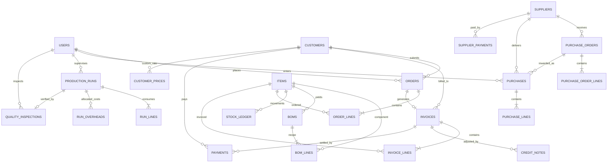

# DATABASE ARCHITECTURE & SCHEMA REFERENCE
## Dakshin ERP (SnackFlow Operating System)
### Enterprise Order-to-Audit Manufacturing Platform

---

## 1. Architectural Principles & Guarantees

### 1.1 Zero-Drift Stock Principle
In Dakshin ERP, inventory balances are **never stored as mutable static columns** that can be arbitrarily overwritten. Instead, the current stock on-hand for any material or finished product is derived from the perpetual, immutable `stock_ledger` table:
$$\text{Stock Balance}(item, t) = \sum_{i \in \text{Ledger}(item), \, \tau(i) \le t} \text{qty\_milli}_i$$
This guarantees that the ledger always equals physical reality and can withstand forensic audit scrutiny.

### 1.2 Exact Decimal / Integer Arithmetic
- **Currency:** Stored in **integer paise** (`1 INR = 100 paise`). All tax allocations (CGST, SGST, IGST) and line totals are rounded using Banker's / Half-Up exact decimal math (`Decimal.quantize()`), preventing fractional paisa drift across large invoice registers.
- **Physical Quantities:** Stored in **integer milligrams** or millipieces (`qty_milli`, where `1.000 kg = 1,000,000 mg`, `1 packet = 1,000 milli`). This accommodates recipes requiring fractional spice dosages (e.g. `1.2 kg = 1,200,000 mg`) with zero floating-point imprecision.

### 1.3 Referential Integrity & ACID Transactions
- Foreign keys are enforced on every database connection (`PRAGMA foreign_keys = ON;`).
- Write-Ahead Logging (`PRAGMA journal_mode = WAL;`) ensures non-blocking concurrent reads during high-frequency write operations.
- Multi-step business workflows execute within atomic context managers (`with tx(db): ...`). If any constraint check fails (such as insufficient stock during dispatch), the entire transaction rolls back cleanly.

---

## 2. Entity-Relationship (ER) Diagram

---

## 3. Core Relational Entities & Data Dictionary

### 3.1 Identity & Access Control
- **`users`**: System personas (`salesman`, `admin`, `production`, `accountant`, `owner`) with PBKDF2-hashed passwords.
- **`audit_log`**: Comprehensive immutable trail capturing `ts`, `user_id`, `entity`, `entity_id`, `action`, `prev_value`, and `new_value`.

### 3.2 Masters & Catalogs
- **`items`**: Catalog SKUs across `raw`, `packaging`, and `finished` goods. Stores `base_unit` (`kg`, `l`, `piece`, `packet`), `hsn` code, GST basis points (`gst_bp`), `reorder_level_milli`, `safety_stock_milli`, `shelf_life_days`, and standard cost.
- **`customers`**: Retailers and distributors with GSTIN, 2-digit state code (`33` for Tamil Nadu, `29` for Karnataka), contact details, credit limits, and assigned field salesman.
- **`customer_prices`**: Overrides default item selling price for designated customer contracts.
- **`suppliers`**: Approved vendor directory with GSTIN, contact person, lead times in days, payment terms, and vendor quality rating.
- **`boms` & `bom_lines`**: Recipe definitions mapping finished product output to exact standard raw and packaging material requirements per standard batch.

### 3.3 Inventory & Perpetual Ledger
- **`stock_ledger`**: The primary single source of truth for all materials.
  - `move_type`: `'opening'`, `'purchase'`, `'production_issue'`, `'production_output'`, `'dispatch'`, `'sales_return'`, `'adjustment'`, `'reversal'`, `'scrap'`.
  - `source_type` & `source_id`: Foreign link to the initiating business document (`purchase`, `production_run`, `invoice`, etc.).
  - `batch_no`, `lot_no`, `expiry`: Batch tracking parameters enabling First-Expired-First-Out (FEFO) picking and instant backward/forward recall.

### 3.4 Procurement Engine
- **`purchase_orders`** & **`purchase_order_lines`**: Formal purchase requisitions and supplier contracts. Tracks order date, expected delivery, and approval status (`draft`, `approved`, `partially_received`, `received`, `cancelled`).
- **`purchases`** & **`purchase_lines`**: Material inward records capturing supplier invoice number, Goods Received Note (GRN), lot numbers, expiry dates, purchase rates, and payment status.
- **`supplier_payments`**: Disbursements allocated against supplier accounts and purchase invoices.

### 3.5 Production Engine
- **`production_runs`**: Daily batch records capturing scheduled date, batches issued, expected output (BOM), actual output packets, damaged packaging pouches, cartons consumed, and QA inspection release status.
- **`run_lines`**: Per-material consumption comparison (`planned_milli` vs `actual_milli`) calculating physical usage variance.
- **`run_overheads`**: Direct and indirect operational costs (e.g. Labour ₹1,200, Gas/Power ₹600) allocated to calculate comprehensive cost-per-packet.

### 3.6 Sales & Billing Engine
- **`orders`** & **`order_lines`**: Field sales orders captured via mobile or admin desk. Includes idempotency `client_uuid`, priority levels, delivery dates, and status transitions (`submitted` → `approved` → `invoiced` → `dispatched`).
- **`invoices`** & **`invoice_lines`**: Formal GST-compliant tax invoices. Tracks financial year (`fy`), place of supply (`intra` vs `inter`), taxable base, CGST, SGST, IGST, and dispatch timestamp.
- **`credit_notes`**: Formal credit adjustments for sales returns or billing corrections (prevents arbitrary deletion of posted invoices).
- **`payments`**: Payment collections applied to invoices and customer accounts.

### 3.7 Quality, Governance & Intelligence
- **`quality_inspections`**: QA records for raw material inwarding, work-in-progress, and finished goods testing (moisture %, seal integrity, defect count, verdict).
- **`lost_sales`**: Unfulfilled customer demand caused by stock or capacity deficits.
- **`system_alerts`**: Automated exception monitor flags (low stock, expiring lots, approval bottlenecks).
- **`daily_closings`**: Snapshot archive of day-end cash, stock, and ledger reconciliation.
