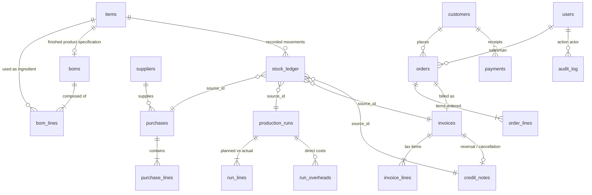

# Architectural Design Note: DakshinERP System
**Centre for Digital Infrastructure, NIT Tiruchirappalli**  
*Technical Architecture, Data Modeling, Stock Ledger Engine & Valuation Methodology*

---

## 1. Relational Data Model & Entity-Relationship Architecture

The core design principle of DakshinERP is **strict single-source-of-truth ledger accounting**. Inventory balances are **never** stored as static mutable fields in an item table; they are dynamically computed from an append-only transaction ledger (`stock_ledger`).

### Key Schema Characteristics
1. **Unified Item Model (`items`):** A single master catalog manages raw materials (`raw`), packaging (`packaging`), and finished goods (`finished`). This ensures one cohesive ledger engine handles every physical asset in the factory.
2. **Immutable Stock Ledger (`stock_ledger`):** Every inventory movement logs:
   $$\text{Stock Balance} = \sum \text{qty\_milli} \quad \forall \text{ ledger entries}$$
   Each entry records `move_type` (`opening`, `purchase`, `production_issue`, `production_output`, `dispatch`, `sales_return`, `adjustment`, `reversal`), `source_type` & `source_id`, batch number, expiry date, timestamp, and user ID.
3. **Integer Milli-Unit and Paisa Arithmetic:**
   * Quantities: stored as integer milli-units (e.g. $40\text{ kg} = 40,000\text{ milli-units}$; $1\text{ packet} = 1,000\text{ milli-units}$).
   * Money: stored as integer paise (e.g. $₹7,875.00 = 787,500\text{ paise}$).
   * Eliminates floating-point precision drift across high-volume transactions.

---

## 2. Stock Ledger Mechanics & BOM Consumption Logic

### A. Material Inward (Purchase)
* Inward purchases record items, quantities, and supplier rates.
* Posts a `purchase` entry in `stock_ledger` ($+\text{qty}$, $\text{value} = \text{qty} \times \text{rate}$).
* Updates the item's cumulative weighted-average valuation.

### B. Production Run Execution (Recipe-to-Stock)
1. **Run Initialization:** The supervisor selects product and batch count ($B$). The system expands the BOM:
   $$\text{Planned Qty}_i = \text{BOM Qty}_i \times B$$
   $$\text{Expected Output} = \text{BOM Yield} \times B$$
2. **Material Issue:** Actual raw materials issued are posted to `stock_ledger` as `production_issue` ($-\text{qty}$).
3. **Completion & Output:** Good finished packets are credited to `stock_ledger` as `production_output` ($+\text{qty}$), valued at total materials consumed. Damaged pouches and packaging are deducted as consumption:
   $$\text{Pouches Used} = \text{Good Packets} + \text{Damaged Pouches}$$
   $$\text{Cartons Used} = \lceil \text{Good Packets} \div \text{Carton Pack Size} \rceil \quad (\text{or actual count entered})$$
4. **Variance Detection Algorithm:**
   For each ingredient line and overall yield, variance percentage is computed:
   $$\text{Variance \%} = \frac{\text{Actual} - \text{Planned}}{\text{Planned}} \times 100$$
   A variance is flagged if:
   $$|\text{Actual} - \text{Planned}| \times 10,000 > \text{Tolerance}_{\text{bp}} \times \text{Planned} \quad (\text{Default } 300\text{ bp} = 3.0\%)$$

### C. Order-to-Cash & Dispatch Flow
* **Stock Verification:** Before order approval, available stock is verified:
  $$\text{Available Stock} = \text{On-Hand Stock} - \text{Reserved by Other Approved Orders}$$
* Shortage triggers warning and computes production batches needed:
  $$\text{Batches Needed} = \lceil \text{Shortage} \div \text{BOM Yield} \rceil$$
* **Dispatch:** Decrements finished goods in `stock_ledger` as `dispatch` ($-\text{qty}$). Physical dispatch is strictly blocked if available stock is insufficient to prevent negative inventory.

---

## 3. Costing & Valuation Methodology

### Perpetual Weighted Average Valuation
DakshinERP implements the **Perpetual Weighted Average Cost** method. Food manufacturing involves frequent repeat purchases of commodity agricultural goods (flour, oil, spices) at volatile prices:
$$\text{New Average Rate} = \frac{(\text{Current Qty} \times \text{Current Avg Rate}) + (\text{Receipt Qty} \times \text{Purchase Rate})}{\text{Current Qty} + \text{Receipt Qty}}$$

* **Benchmark Example (Flour):**
  * Opening: $100\text{ kg} @ ₹42.00 = ₹4,200.00$
  * New Purchase: $60\text{ kg} @ ₹45.00 = ₹2,700.00$
  * Total Pool: $160\text{ kg} @ ₹6,900.00 \implies \mathbf{₹43.125\text{ / kg}}$
  * $40\text{ kg}$ issued to production costs: $40 \times 43.125 = \mathbf{₹1,725.00}$.

### Unit Cost per Packet & Overhead Absorption
Production overheads are absorbed under two structured rules:
1. **Direct Run Overheads:** Labour, power, or gas specific to a batch run are charged $100\%$ to that run.
2. **Monthly Common Pool:** Factory-wide overheads (common rent, administration) are distributed across all runs completed in that month in proportion to good packets produced:
   $$\text{Allocated Overhead} = \text{Monthly Pool} \times \left( \frac{\text{Run Good Packets}}{\sum \text{Month Good Packets}} \right)$$

$$\text{Cost per Packet} = \frac{\text{Material Cost} + \text{Packaging Cost} + \text{Direct Overheads} + \text{Allocated Pool}}{\text{Actual Good Packets Produced}}$$
$$\text{Gross Profit Margin} = \text{Selling Price (Pre-Tax)} - \text{Cost per Packet}$$

---

## 4. GST Taxation & Statutory Compliance Architecture

1. **Place of Supply Logic:**
   * **Intra-State:** Customer state code equals factory state code ($33\text{, Tamil Nadu}$) $\implies$ **CGST (2.5%) + SGST (2.5%)**.
   * **Inter-State:** Customer state code differs (e.g. $29\text{, Karnataka}$) $\implies$ **IGST (5.0%)**.
2. **Paisa-Level Rounding:** Tax is computed per invoice line using `Decimal` arithmetic and rounded half-up to the nearest paisa ($0.5\text{ paise} \to 1\text{ paisa}$) to eliminate aggregate tax divergence.
3. **Sequential Financial-Year Numbering:** Formatted as `INV/YYYY-YY/XXXX` (e.g. `INV/2026-27/0001`), resetting annually.
4. **Audit Immutability:** Posted invoices cannot be deleted. Corrections require issuing a formal credit note, which automatically generates accounting debit/credit adjustments and reverses inventory in `stock_ledger`.
