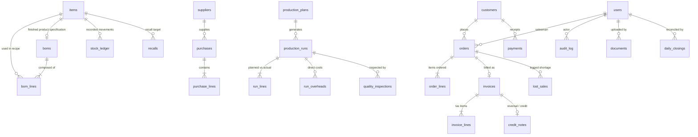

# Architectural Design & Technical Specification: SnackFlow ERP

> **SnackFlow ERP**  
> *Smart Manufacturing, Sales, Inventory, Finance and Audit Intelligence System*  
> **Tagline:** *"From Order to Audit. Every Transaction Connected."*  
> **Originating Benchmark:** Centre for Digital Infrastructure, National Institute of Technology, Tiruchirappalli (NIT-T)  
> *Winter Internship Shortlisting Problem Statement: Order-to-Audit System for a Small Food Manufacturer*

---

## 1. Executive Summary & Core Architectural Tenets

SnackFlow ERP is a full-stack, enterprise-grade manufacturing execution and enterprise intelligence platform designed for small-to-midsize packaged food manufacturers (e.g., savory snacks, murukku, mixture, banana chips, sweets). It bridges physical shop floor execution (recipe-based BOM production, raw material yields, QC batch cards) with business governance (GST tax invoicing, field sales automation, credit risk, audit readiness, and cash flow forecasting).

### Key Architectural Tenets:
1. **Single Source of Truth (Zero-Drift Stock Ledger):**  
   Stock balances are **never** stored as mutable, static numbers on items. Current physical inventory is always dynamically aggregated from an immutable, append-only ledger (`stock_ledger`):
   $$\text{Stock Balance} = \sum \text{qty\_milli} \quad \forall \text{ active movements}$$
2. **Strict Integer Milli-Unit & Paisa Arithmetic:**  
   To eliminate floating-point rounding errors and accumulator drift across millions of transactions:
   * **Quantities:** Integer milli-units ($1\text{ kg} = 1,000\text{ milli-units}$; $1\text{ packet} = 1,000\text{ milli-units}$).
   * **Monetary Values:** Integer paise ($₹1.00 = 100\text{ paise}$).
   * **Tax & Variance Rates:** Integer basis points ($1\% = 100\text{ bp}$).
3. **Pure In-Memory Pro-Forma Simulations:**  
   What-If simulations, capacity planners, and digital factory twin projections operate purely in-memory. They never mutate or leak temporary records into the live transaction tables or stock ledger.
4. **End-to-End Bidirectional Traceability:**  
   From inward raw material purchase batches to shop floor production runs, finished goods packaging, outward GST invoices, customer delivery, and bank payment receipts.

---

## 2. Relational Data Model & Schema Architecture

SnackFlow ERP operates on 30 normalized relational tables managed with foreign key enforcement (`PRAGMA foreign_keys = ON;`) and ACID transaction boundaries.

### 2.1 Core Operational Tables (23 Tables)
1. `users`: Credentials (salted scrypt hashes), roles (`salesman`, `admin`, `production`, `accountant`, `owner`), active status.
2. `items`: Master catalog of raw materials (`raw`), packaging (`packaging`), and finished goods (`finished`). Includes `safety_stock_milli`, `standard_cost_paise`, and unit of measurement.
3. `boms`: Bill of Materials header (product ID, standard batch yield in packets, batch size).
4. `bom_lines`: Recipe ingredients with quantity in milli-units and waste tolerance basis points.
5. `suppliers`: Vendor details, GSTIN, payment terms, `lead_time_days`, and historical `rating`.
6. `purchases`: Inward goods receipt note (GRN) header, invoice number, date, total amount.
7. `purchase_lines`: Inward items, received quantities, unit purchase rates, batch number, and expiry date.
8. `production_runs`: Batch run header, target product, batch count, start/finish times, status, and `qa_status`.
9. `run_lines`: Per-ingredient planned vs actual consumption, scrap quantities, and variance basis points.
10. `run_overheads`: Specific direct batch overheads (labour, power, fuel).
11. `stock_ledger`: Immutable inventory transaction ledger (`opening`, `purchase`, `production_issue`, `production_output`, `dispatch`, `sales_return`, `adjustment`, `reversal`).
12. `customers`: Client records, state code (for GST place-of-supply), credit terms, and `credit_limit_paise`.
13. `customer_prices`: Customer-specific custom pricing overrides per item.
14. `orders`: Sales order header, order number, customer ID, order date, total paise, approval status (`draft`, `submitted`, `approved`, `fulfilled`, `cancelled`).
15. `order_lines`: Line items, ordered quantity, unit price, tax rate.
16. `invoices`: Official GST tax invoice header, financial year invoice number (`INV/YYYY-YY/XXXX`), date, taxable amount, CGST, SGST, IGST, total amount, status (`issued`, `paid`, `cancelled`).
17. `invoice_lines`: Itemized invoice lines with HSN code, taxable rate, and tax amounts.
18. `credit_notes`: Tax credit notes for sales returns and invoice cancellations with reverse ledger posting.
19. `payments`: Cash/bank/UPI receipts linked to customers and invoices.
20. `audit_log`: Tamper-evident trail capturing timestamp, user ID, action, entity name, entity ID, and change summary.
21. `sales_visits`: Mobile GPS check-in logs with geolocation coordinates, accuracy, and customer visit notes.
22. `overhead_pools`: Factory-wide monthly indirect overhead pools for period absorption.
23. `monthly_closings`: Sealed historical inventory closing balances per item per calendar month.

### 2.2 Intelligence & Governance Tables (7 Tables)
24. `production_plans`: Demand-driven MRP plans capturing suggested batch counts, shortfall, BOM material explosion, status (`proposed`, `approved`, `scheduled`, `completed`), and created timestamps.
25. `quality_inspections`: Quality assurance inspection records across 6 food safety parameters (moisture %, frying temperature °C, seal integrity, weight check, organoleptic crispness/taste, packaging defect count), inspector ID, QA status (`passed`, `quarantine`, `rejected`), and corrective notes.
26. `lost_sales`: Formal tracking of unfulfilled customer demand due to stockouts, capturing customer ID, item ID, lost quantity, lost revenue paise, root cause reason, and date.
27. `alerts`: System-wide notification hub storing alert type (`low_stock`, `expiry_risk`, `variance_breach`, `credit_limit_exceeded`, `payment_overdue`), severity (`info`, `warning`, `critical`), message, entity reference, read status, and resolution timestamps.
28. `documents`: Compliance document vault tracking document title, category (`fssai`, `gst`, `iso`, `lab_test`, `audit_report`, `sop`), filename, file path, MIME type, file size bytes, expiry date, upload user, and SHA-256 integrity hash.
29. `recalls`: Mock and live food safety batch recall manager tracking product ID, batch number, reason, affected quantity, recalled quantity, disposal method, regulatory notification date, and status (`initiated`, `in_progress`, `completed`, `audited`).
30. `daily_closings`: End-of-day statutory reconciliation snapshots capturing closing date, total orders count, total invoices paise, collections paise, production output packets, stock discrepancies, cash reconciled flag, auditor sign-off notes, and closing user ID.

---

## 3. Stock Ledger Engine & Valuation Methodology

### 3.1 Immutable Stock Movement Matrix

| Event | Movement Type | `stock_ledger.qty_milli` | Inventory Account Impact | Valuation Source |
|---|---|:---:|---|---|
| Opening Balance | `opening` | $>0$ | Raw / Pack / FG Stock Debit | Opening Unit Cost |
| Material Inward | `purchase` | $>0$ | Raw / Pack Stock Debit | Purchase Line Rate |
| Batch Execution | `production_issue` | $<0$ | Raw / Pack Stock Credit | Item Perpetual W.A. Cost |
| Batch Completion | `production_output` | $>0$ | Finished Goods Debit | $\sum \text{Consumed Materials} + \text{Direct Overheads}$ |
| Order Dispatch | `dispatch` | $<0$ | Finished Goods Credit | Production Unit Cost |
| Sales Return | `sales_return` | $>0$ | Finished Goods Debit | Original Dispatch Unit Cost |
| Physical Adjustment | `adjustment` | $\gtrless 0$ | Inventory Adjustment P&L | Current Perpetual W.A. Cost |
| Credit Note Reversal | `reversal` | $>0$ | Stock Reinstatement | Original Dispatch Cost |

### 3.2 Perpetual Weighted Average Valuation
Food manufacturing relies on commodity inputs (flour, oil, pulses) purchased at fluctuating rates. SnackFlow ERP updates average cost continuously upon every inward purchase:
$$\bar{R}_{\text{new}} = \frac{(Q_{\text{current}} \times \bar{R}_{\text{current}}) + (Q_{\text{inward}} \times R_{\text{inward}})}{Q_{\text{current}} + Q_{\text{inward}}}$$

#### Section 5 Benchmark Execution:
* Opening Flour: $100\text{ kg} @ ₹42.000\text{/kg} = ₹4,200.00$
* Inward Receipt: $60\text{ kg} @ ₹45.000\text{/kg} = ₹2,700.00$
* Resulting Pool: $160\text{ kg} \implies \text{Weighted Average} = \mathbf{₹43.125\text{/kg}}$
* $40\text{ kg}$ issued for Run 1: $40 \times 43.125 = \mathbf{₹1,725.00}$.

### 3.3 FEFO (First-Expiry-First-Out) Batch Allocation
When stock is issued to the shop floor or dispatched to customers, SnackFlow ERP's FEFO engine selects inventory batches according to:
$$\text{Priority} = \operatorname{argmin}_{\text{batch} \in \text{Available Batches}} (\text{Expiry Date})$$
* **Non-Expired Guard:** Batches where $\text{Expiry Date} \le \text{Today}$ are automatically quarantined.
* **Traceable Override:** Supervisors may override FEFO only by specifying a mandatory reason code (e.g. `customer_batch_specification`, `location_access_block`), logged in the immutable audit trail.

---

## 4. Production Economics, Yield & Variance Algorithms

### 4.1 Cost per Packet Formulation
Direct production cost per saleable unit is strictly defined as:
$$\text{Unit Cost} = \frac{\sum_{\text{raw}} (\text{Qty}_{\text{actual}} \times \bar{R}) + \sum_{\text{pack}} (\text{Qty}_{\text{used}} \times R_{\text{pack}}) + \text{Direct Overheads} + \text{Allocated Pool}}{\text{Good Finished Packets Produced}}$$

#### Benchmark Run 1 Economics:
* Flour ($40\text{ kg} @ ₹43.125$): $₹1,725.00$
* Cooking Oil ($10.5\text{ L} @ ₹140.00$): $₹1,470.00$
* Spice Mix ($1.2\text{ kg} @ ₹200.00$): $₹240.00$
* Pouches ($188\text{ good} + 6\text{ damaged} = 194\text{ pcs} @ ₹2.50$): $₹485.00$
* Corrugated Cartons ($9\text{ boxes} @ ₹15.00$): $₹135.00$
* **Direct Overheads:** Labour $₹1,200.00$ + Power/Gas $₹600.00 = ₹1,800.00$
* **Total Run Cost:** $₹4,055.00 + ₹1,800.00 = \mathbf{₹5,855.00}$
* **Final Cost per Packet:** $₹5,855.00 \div 188\text{ good packets} = \mathbf{₹31.1436} \approx \mathbf{₹31.14}$
* **Gross Profit Margin:** $₹50.00\text{ selling price} - ₹31.14 = \mathbf{₹18.86\text{ (37.7\% margin)}}$.

### 4.2 Two-Dimensional Variance Detection
Variance is monitored on two distinct vectors:
1. **Yield Variance:**
   $$\Delta_{\text{yield}} = \frac{\text{Good Packets} - \text{Expected BOM Yield}}{\text{Expected BOM Yield}} \times 100\% = \frac{188 - 200}{200} \times 100\% = \mathbf{-6.00\%}$$
2. **Ingredient Consumption Variance (e.g. Cooking Oil):**
   $$\Delta_{\text{oil}} = \frac{10.5\text{ L} - 10.0\text{ L}}{10.0\text{ L}} \times 100\% = \mathbf{+5.00\%}$$
* **Threshold Flag:** Any absolute variance exceeding $3.00\%$ ($300\text{ bp}$) generates automated warnings on the Control Tower, alerts table, and auditor variance reports.

---

## 5. Intelligence Engine Architectures

### 5.1 Smart Factory Control Tower
The Control Tower synthesizes real-time metrics across all 30 tables into a high-level operational pulse:
* **Workflow Funnel:** $\text{Order} \to \text{Approval} \to \text{Production} \to \text{Quality} \to \text{Finished Stock} \to \text{Invoice} \to \text{Dispatch} \to \text{Payment} \to \text{Audit}$.
* **Live KPI Deck:** Revenue today, gross profit margin, active alerts, inventory health, delayed dispatches, unfulfilled demand.

### 5.2 Multi-Dimensional Inventory Health Scoring Algorithm
The inventory health score is an explainable $0-100$ point index calculated across four weighted operational dimensions:
1. **Stock Shortage Dimension (30 pts max):** Deducts points for items with available stock below safety thresholds or unfulfilled order lines.
2. **Stockout Risk Dimension (25 pts max):** Penalizes items where projected runway is $<7$ days based on 30-day average daily burn rate.
3. **Overstock / Dead Stock Dimension (25 pts max):** Deducts points for items with $>90$ days runway or zero movement within the last 30 days.
4. **Expiry Risk Dimension (20 pts max):** Evaluates finished and raw goods expiring within 30 days without scheduled consumption.
$$\text{Health Score} = S_{\text{shortage}} + S_{\text{stockout}} + S_{\text{overstock}} + S_{\text{expiry}}$$
* The engine emits detailed diagnostic reasoning strings alongside the numerical score.

### 5.3 Smart Reorder Predictor
Analyzes historical daily consumption rate ($\bar{C}_{\text{daily}}$), active pending orders requirement ($D_{\text{pending}}$), supplier lead time ($L_{\text{days}}$), and safety stock ($S_{\text{safety}}$):
$$\text{Reorder Point (ROP)} = (\bar{C}_{\text{daily}} \times L_{\text{days}}) + S_{\text{safety}}$$
$$\text{Recommended Order Qty} = \max(0, \text{ROP} + D_{\text{pending}} - Q_{\text{available}} - Q_{\text{on\_order}})$$
* Provides a 1-click requisition workflow to convert approved recommendations directly into purchase orders.

### 5.4 Root Cause Analysis (RCA) Decision Engine
When yield, wastage, or dispatch delays breach tolerances, the RCA engine executes deterministic diagnostic rules:
* **Ingredient Ratio Analysis:** Correlates oil-to-flour ratio deviations with pouch seal failures or low yield.
* **Packaging Quality Check:** Flags suppliers whose pouch damage rate exceeds $2.5\%$.
* **Equipment & Operator Diagnostics:** Analyzes variance anomalies clustered around specific machinery or supervisor shifts.

### 5.5 Pro-Forma What-If Simulation Engine
Enables factory owners to model scenario projections before committing capital:
$$\Delta \text{Profit} = \Delta \text{Volume} \times (P_{\text{new}} - C_{\text{new}}) - \Delta \text{Fixed Overheads}$$
* Parameters: Raw material price fluctuation ($\pm 50\%$), production yield shift ($\pm 20\%$), packaging cost adjustment ($\pm 30\%$), and sales volume swings ($\pm 50\%$).
* **Guaranteed Safety:** Pure in-memory calculation; no temporary records are written to `stock_ledger` or `invoices`.

### 5.6 6-Pillar Audit Readiness Scoring Engine
Calculates statutory compliance readiness across 6 distinct evaluation pillars:
1. **Ledger Integrity:** Zero negative balances, zero orphaned transactions ($100\%$).
2. **GST Compliance:** Matching CGST/SGST, valid HSN classifications, sequential invoice numbering.
3. **Traceability:** $100\%$ of production batches linked to raw material GRNs and finished goods dispatches.
4. **Voucher Reconciliation:** Payments matched against tax invoices with zero unaccounted balances.
5. **Physical Reconciliation:** Daily closing sign-offs and physical audit discrepancy rates.
6. **Statutory Document Currency:** Active FSSAI licenses, ISO certifications, and periodic water/product lab tests.

---

## 6. Statutory GST Architecture & Accounting Standards

1. **Place of Supply Logic (Section 10, IGST Act):**
   * **Intra-State:** Customer State Code == Factory State Code (`33, Tamil Nadu`) $\implies$ **CGST (2.5%) + SGST (2.5%)**.
   * **Inter-State:** Customer State Code != Factory State Code (e.g. `29, Karnataka`) $\implies$ **IGST (5.0%)**.
2. **Paisa-Level Rounding:**
   Calculated per line item using `Decimal` arithmetic with `ROUND_HALF_UP` to the nearest paisa ($0.5\text{ paise} \to 1\text{ paisa}$).
3. **Statutory Formats:**
   * **GSTR-1:** Export table formatting for B2B Table 4A and HSN Table 12.
   * **GSTR-3B:** Pre-aggregated summary mapping directly to Table 3.1(a) taxable turnover and tax liabilities.
   * **Tally Prime Compatibility:** Exportable XML vouchers structured with standard Tally XML tags (`VOUCHER`, `ALLLEDGERENTRIES.LIST`) for one-click accounting synchronization.

---

## 7. Security, Access Control & Deployment Topology

### 7.1 Role-Based Access Control (RBAC) Matrix

| Endpoint Blueprint | Salesman | Production | Admin | Accountant | Owner |
|---|:---:|:---:|:---:|:---:|:---:|
| Field Order Entry (`/sales/*`) | ✅ | ❌ | ✅ | ❌ | ✅ |
| Shop Floor Receipts & Runs (`/prod/*`) | ❌ | ✅ | ✅ | ❌ | ✅ |
| Order Approval & Dispatch (`/admin/*`) | ❌ | ❌ | ✅ | ❌ | ✅ |
| GST Invoicing & Payments (`/admin/*`) | ❌ | ❌ | ✅ | ✅ | ✅ |
| Auditor Hub & Tally XML (`/reports/*`) | ❌ | ❌ | ❌ | ✅ | ✅ |
| Control Tower & Simulators (`/intel/*`) | ❌ | ❌ | ✅ | ✅ | ✅ |

### 7.2 Security Hardening
* **Password Hashing:** Werkzeug `scrypt` hashing with secure per-user salt.
* **Session Security:** `SESSION_COOKIE_HTTPONLY = True`, `SESSION_COOKIE_SAMESITE = "Lax"`.
* **HTTP Security Headers:** Automatic injection of `X-Content-Type-Options: nosniff`, `X-Frame-Options: SAMEORIGIN`, `X-XSS-Protection: 1; mode=block`, and `Referrer-Policy: strict-origin-when-cross-origin`.
* **Safe Parameterization:** All SQL queries execute via parameterized SQLite bindings (`?`), fully immune to SQL injection.
